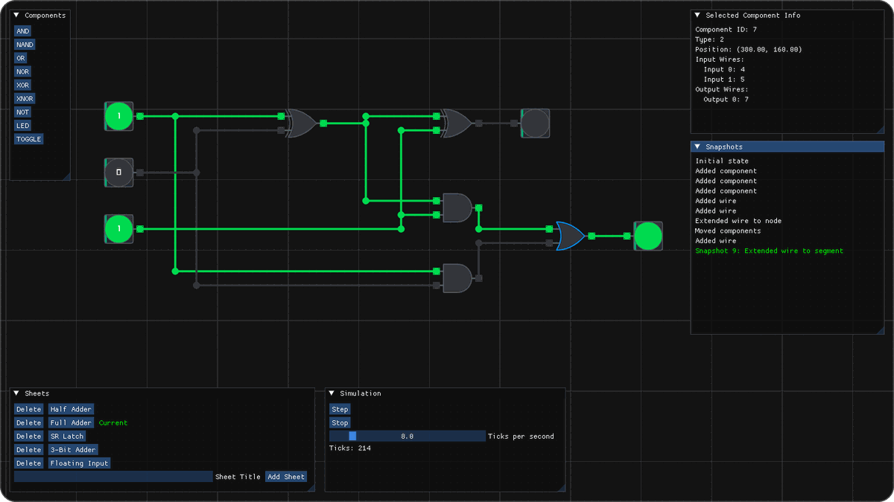
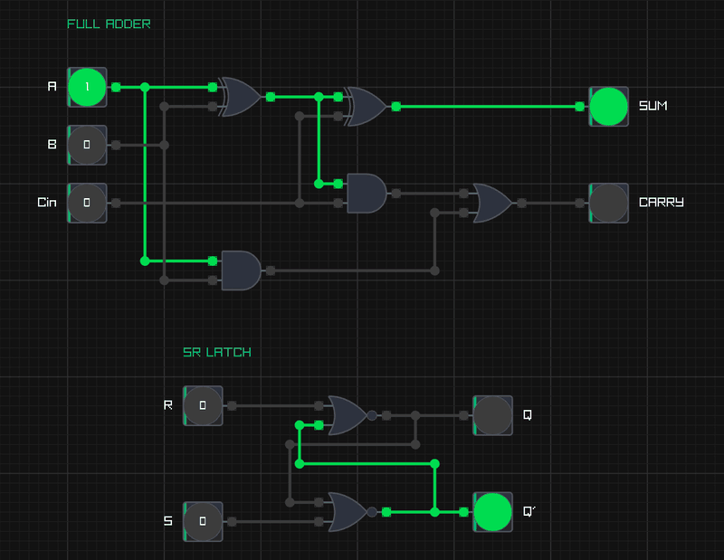
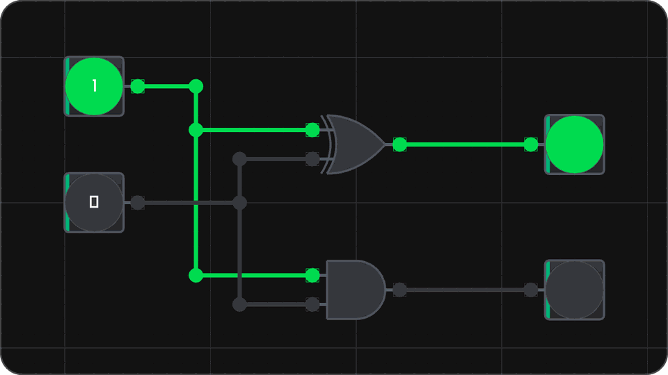
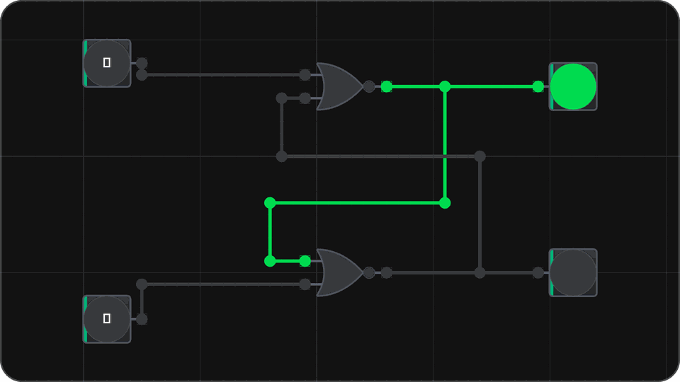
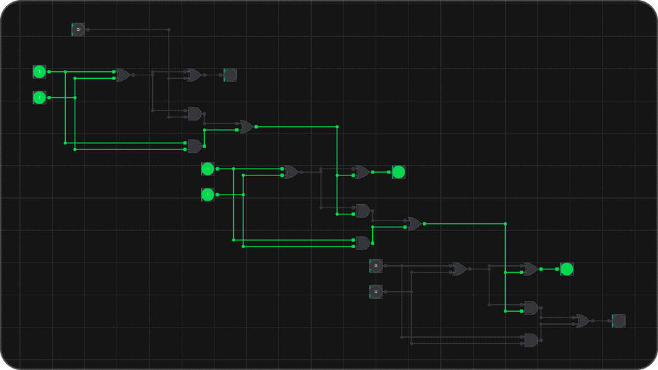
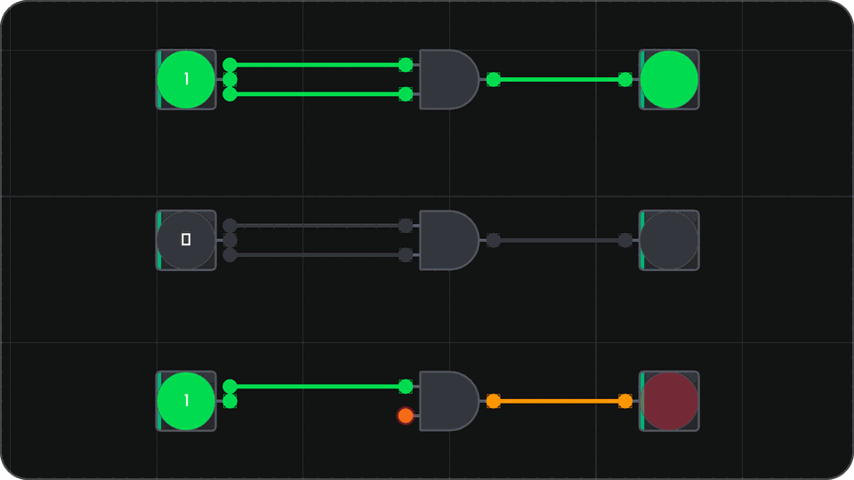

# Latch

Latch is a desktop sandbox for building digital circuits out of logic gates. You
place gates on an infinite grid, wire them together, flip some switches, and
watch the signals move through the circuit one tick at a time. It's written in
C++20, with [raylib](https://www.raylib.com/) doing the rendering and
[Dear ImGui](https://github.com/ocornut/imgui) handling the panels.

<p align="center">
  
</p>

<p align="center">
  
</p>

<p align="center"><em>A full adder stepping through every input, and an SR latch holding its value after the set and reset pulses end.</em></p>

## Features

- **Nine components.** `AND`, `NAND`, `OR`, `NOR`, `XOR`, `XNOR` and `NOT` for
  the logic, a `TOGGLE` switch to drive inputs, and an `LED` to show outputs.
- **Three-valued logic.** Every signal is `LOW`, `HIGH` or `UNDEFINED`. A gate
  with a floating input doesn't pretend it knows its output, it says it's
  undefined. Wires are colored by the value they carry, so you can see this at a
  glance.
- **Right-angle wiring.** Wires route as L-shaped bends. The bend direction
  follows the way you drag, and you can flip it by dragging back to where you
  started.
- **Branching wires.** You can start a wire from an output pin, a free input
  pin, or anywhere on an existing wire, so one output can feed as many inputs as
  you want. Individual nodes and segments can be selected and deleted.
- **Auto-rerouting.** Move a gate, or a group of nodes, and the wires attached
  to it reroute themselves.
- **Simulation control.** Step one tick at a time, or let it run at anywhere
  from 0.5 to 60 ticks per second.
- **Editing tools.** Box selection, copy and paste, delete, and undo/redo.
- **Infinite canvas.** Pan and zoom freely. Components snap to the grid.
- **Multiple sheets.** Each sheet is its own circuit in its own tab. The
  clipboard is shared between them, so you can copy from one sheet and paste
  into another.
- **Saving and loading.** Sheets save to JSON files. A tab shows a dot when it
  has changes that aren't on disk yet, and undoing back to the saved state
  clears it again.

## Screenshots

<table>
  <tr>
    <td width="50%" valign="top">
      <br>
      <b>Half adder</b>: <code>XOR</code> gives the sum and <code>AND</code> gives the carry.
      Each input branches into both gates. <code>1 + 0 = 01</code>.
    </td>
    <td width="50%" valign="top">
      <br>
      <b>SR latch</b>: two cross-coupled <code>NOR</code> gates. After the set pulse is released
      both inputs are low, and <code>Q</code> stays high. The circuit remembers.
    </td>
  </tr>
  <tr>
    <td width="50%" valign="top">
      <br>
      <b>3-bit ripple-carry adder</b>: three full adders, each one's carry feeding the next.
      <code>011 + 011 = 110</code>.
    </td>
    <td width="50%" valign="top">
      <br>
      <b>Three-valued logic</b>: <code>HIGH</code> and <code>LOW</code> work as you'd expect. The
      bottom gate has a floating input, so its output is <code>UNDEFINED</code> instead of a guess.
    </td>
  </tr>
</table>

## Controls

### Mouse

| Action | Control |
| --- | --- |
| Place the selected component | Right-click on the canvas |
| Move a gate or a selection | Left-drag it |
| Draw a wire | Left-drag from an output pin, a free input pin, a wire node or a wire segment |
| Flip a switch | Left-click a `TOGGLE` |
| Box select | Hold **Shift** and left-drag |
| Pan | Left-drag on empty canvas |
| Zoom | Mouse wheel |

You pick what right-click places from the **Components** panel.

### Keyboard

| Action | Key |
| --- | --- |
| Step the simulation once | **Space** |
| Delete the selection | **Delete** |
| Copy the selection | **Ctrl + C** |
| Paste at the cursor | **Ctrl + V** |
| Undo | **Ctrl + Z** |
| Redo | **Ctrl + Y** |
| Save | **Ctrl + S** |

Shortcuts only work while the cursor is over the canvas and no text field has
focus, so typing into a panel doesn't delete half your circuit.

### The menu bar and tabs

The **File** menu at the top has three entries:

- **Save** writes the sheet back to its file. If the sheet has never been saved,
  it acts like Save as.
- **Save as** asks where to save, and suggests the sheet's title as the file
  name. The sheet then takes the file's name as its title.
- **Load file** opens a circuit as a new tab. If that file is already open, it
  just switches to its tab instead of opening it twice.

The file dialogs start in a `saves` folder next to the executable, which Latch
creates the first time you save.

Right under the menu bar is the tab bar with one tab per sheet. **+** adds a new
sheet, the **×** on a tab closes it, and you can drag tabs to reorder them. The
last tab can't be closed, so there's always a sheet to work on.

### Panels

- **Components** picks the component type for right-click placement. It's
  shared across all sheets.
- **Simulation** has `Step`, `Run`/`Stop`, a ticks-per-second slider, and the
  tick count for the current sheet.
- **Selected Component Info** shows the details of the selected gate or wire
  node. It's mostly a debugging aid.
- **Snapshots** lists the current sheet's undo history, with the state you're on
  highlighted.

## Building

Latch builds with **CMake** (3.21 or newer) on any platform. Every dependency is
downloaded at configure time, so all you need installed is CMake, a C++20
compiler and Git. MSVC (Visual Studio 2022), GCC and Clang all work.

### With presets

The repo comes with a `CMakePresets.json`. Configure, then build:

```bash
cmake --preset vs
cmake --build --preset vs
```

There are two presets:

- **`vs`** uses the Visual Studio 2022 generator for x64 Windows and builds into
  `build/vs/`.
- **`ninja`** is a single-config Ninja Debug build that works with GCC, Clang or
  MSVC. It builds into `build/ninja/`.

Visual Studio 2022 can also open the folder directly. It reads the presets and
lists them in the configuration dropdown.

### Without presets

```bash
cmake -S . -B build
cmake --build build --config Debug
```

With the `vs` preset the executable ends up at `build/vs/src/Debug/Latch.exe`.
Everything is linked statically, so there are no DLLs to copy next to it.

### Tests

The tests use [Catch2](https://github.com/catchorg/Catch2) and are built by
default when Latch is the top-level project. Build, then run them through CTest:

```bash
cmake --build --preset vs
ctest --preset vs --output-on-failure
```

For a Ninja build, use `ctest --preset ninja --output-on-failure` instead. Each
`TEST_CASE` is registered with CTest on its own. You can also run the test
binary directly and use
[Catch2's filters and tags](https://github.com/catchorg/Catch2/blob/devel/docs/command-line.md),
for example to run only the gate tests:

```bash
./build/vs/tests/Debug/latch_tests.exe "[gate]"
```

The tests run on `latch_core` without opening a window. They cover the gate
truth tables, circuit evaluation and signal propagation, wire routing, and the
id bookkeeping. They check what the circuit settles to, not how many ticks it
takes to get there. The evaluator is going to be rewritten, and I didn't want
that to break the whole suite.

To skip the tests completely, configure with `-DLATCH_BUILD_TESTS=OFF`. That
also skips downloading Catch2.

## Dependencies

CMake pulls all of these with `FetchContent` at configure time. That's why Git
is required, and why there's nothing to install or vendor by hand.

- **raylib** `6.0` for the window, input and 2D rendering.
- **Dear ImGui** `v1.92.1` and **rlImGui** for the panels and the raylib backend
  that draws them.
- **nlohmann/json** `v3.12.0` for reading and writing the save files.
- **Native File Dialog Extended** `v1.2.1` for the native open and save dialogs.
- **Catch2** `v3.7.1` for the tests, only when they're enabled.

## Project layout

```
src/
  main.cpp            Entry point
  App.{h,cpp}         Window loop, input, menu bar, sheet tabs, save/load, shared clipboard
  Sheet.{h,cpp}       One circuit's editor: camera, selection, mouse state machine,
                      undo history and the simulation panel
  Circuit.{h,cpp}     Component and wire storage, evaluation, snapshots
  Gate.{h,cpp}        The gate base class and each gate's logic
  Wire.{h,cpp}        Wire geometry: nodes, segments and routing
  ComponentInfo.{h,cpp}  Serializable description of a component
  Serializer.{h,cpp}  Saving and loading sheets, and validating loaded files
  Settings.{h,cpp}    View, grid and color theme settings
  Pin.h               Logic levels and pin references
  Action.h            Undo/redo snapshot history
  IdManager.h         Stable id to index mapping
  CMakeLists.txt      latch_core library and Latch executable
tests/                Catch2 unit tests
CMakeLists.txt        Top-level build: dependencies and options
CMakePresets.json     Configure, build and test presets
```

## How it works

The `App` owns the window loop and the list of open sheets. Every frame it reads
the mouse and keyboard and passes them to the current sheet, along with the
shared clipboard and the selected component type.

A `Sheet` is one `Circuit` plus everything needed to edit it: the camera, the
selection, the undo history and the simulation state. Mouse handling is a small
state machine with five states: `Idle`, `Panning`, `Dragging`, `Connecting` and
`Selecting`. Things like delete, copy, paste, undo and step are methods on
`Sheet` that the `App` calls from the keyboard shortcuts.

`Circuit` holds the gates and wires and runs the simulation. Each tick, every
wire takes the value of the pin driving it, then every gate looks up its output
in a small three-valued truth table. That means a signal moves forward one gate
per tick, and a bigger circuit needs a few ticks to settle.

A wire isn't a line from A to B. It's a little graph of nodes and segments with
one source and any number of destinations, which is how one output can branch
out to several inputs.

### Undo and saving

Every edit stores a full snapshot of the circuit in the `ActionManager`. Undo and
redo just restore an older or newer snapshot, and the Snapshots panel is a list
of them.

Saving reuses those same snapshots. The `Serializer` writes the snapshot and the
sheet's simulation settings to a JSON file. It writes to a temporary file first
and renames it over the real one, so a crash halfway through a save can't leave
you with half a file.

Each snapshot has an id, and the sheet remembers the id it was last saved at.
If the current snapshot's id doesn't match, the sheet has unsaved changes and
the tab shows its dot. A sheet that has never been saved counts as unsaved.

Loading goes the other way, but it doesn't trust the file. A hand-edited or
corrupted save could point a wire at a gate that doesn't exist, or give a gate
the wrong number of pins, and restoring that would crash the app. So before
anything gets restored, the loaded snapshot is checked: every wire has a real
source pin, every gate's inputs and outputs point at wires that really connect
to them, and the id tables map every id to exactly one object. If anything is
off, the load is skipped and the error is printed to the console, and the sheets
you already have open stay as they were.

## License

Latch is released under the [MIT License](LICENSE). Its dependencies come with
their own licenses: [raylib](https://www.raylib.com/) (zlib/libpng),
[Dear ImGui](https://github.com/ocornut/imgui) (MIT),
[nlohmann/json](https://github.com/nlohmann/json) (MIT) and
[Native File Dialog Extended](https://github.com/btzy/nativefiledialog-extended) (zlib).
